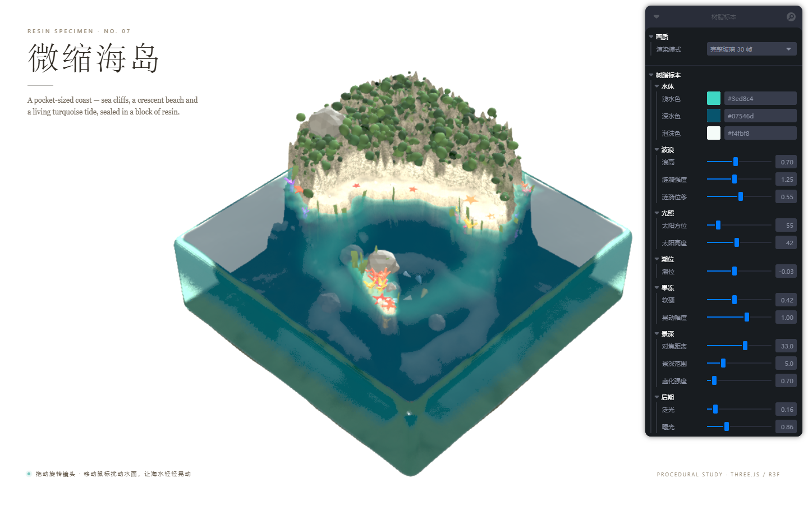

# 树脂标本 · 微缩海岛

一块装满海水的透明树脂方块，里面封着一座程序化生成的小岛。全屏、可交互、实时渲染，无任何模型文件。



## 运行

```bash
npm install
npm run dev      # http://localhost:5173
npm run build    # 类型检查 + 生产构建
npm run preview  # 预览构建产物
```

技术栈：Vite · React 19 · TypeScript · three.js r186 · @react-three/fiber v9 · drei · @react-three/postprocessing · leva。

## 交互

- **拖动画面**：旋转 / 缩放镜头（限制俯仰角，保持产品视角）。
- **移动鼠标 / 拖动手指**：划过水面会激起真实的 GPU 高度场涟漪；水面同时像果冻一样随指针轻轻鼓起、倾斜。岛屿、岩石和树脂外壳保持静止。
- **右上角「树脂标本」面板**（手机上默认收起）：实时调节水质、波浪、光照、潮位、果冻、景深与后期。

| 分组 | 参数 |
| --- | --- |
| 水体 | 浅水色、深水色（默认更深的海蓝）、泡沫色 |
| 波浪 | 浪高、涟漪强度（默认 1.25）、涟漪位移（默认 0.55） |
| 光照 | 太阳方位、太阳高度 |
| 潮位 | 水位 |
| 果冻 | 软硬、晃动幅度 |
| 景深 | 对焦位置、景深范围、虚化强度 |
| 后期 | 泛光、曝光 |

## 实现要点

- **程序化地形**：`src/lib/noise.ts` 里的确定性噪声（fbm / ridged）塑造更大的岛体、陡崖、海湾、宽阔的新月形沙滩与山峰；按高度/坡度分层着色（湿沙、白沙海滩、岩层、苔藓、草地），并烘焙 8-bit 高度图给水面着色器使用。
- **GPU 水面**：`useWaterHeightField` 用 RGBA16F ping-pong 目标求解波动方程，指针高斯凹陷 + 尾迹、边界吸收；水面顶点/片元着色器叠加环境涌浪、焦散、深浅色、菲涅尔天空反射、平面反射与岸边泡沫。
- **树脂外壳**：`RoundedBox` + `MeshTransmissionMaterial`，去掉顶盖让动画水面成为真正的顶面；透射内部场景并带青绿色衰减。
- **海洋生态**：程序化珊瑚丛（橙/粉/紫/黄）、会摆动的海草、绕着沙嘴游动的小鱼群、沙滩上的海星与贝壳；全部实例化，核显档也会保留。
- **沙嘴**：沙滩向潟湖里伸出一条浅水沙舌，末端露出水面，鱼群和珊瑚围绕它分布。
- **果冻感**：`JellyRig` 用欠阻尼弹簧跟随指针，只把偏移送进水面顶点着色器（中心鼓起 + 法线扰动，边缘固定）；外壳、岛屿、岩石完全不动。
- **镜头与质感**：长焦俯视产品镜头 + 带阻尼的 OrbitControls（可旋转/缩放）、接触阴影、Neutral 色调映射、Bloom、暗角、标准景深 DepthOfField（alpha-safe，resolutionScale 0.5），营造微缩模型感。
- **水体**：默认深水色已加深为 ，浅水色 ，海湾处抬高海床形成明亮的青绿浅滩，外圈保留深蓝。
- **画质切换**：Leva 顶部「画质 → 渲染模式」可在「轻量 60 帧」和「完整玻璃 30 帧」之间切换。轻量档：0.75 DPR + 轻量玻璃 + 关闭反射/Bloom/景深，稳定 60fps；完整玻璃档：透射玻璃 + 0.85 DPR，核显实测约 46fps（独显会再打开平面反射、Bloom 与景深）。
- **稳定 60fps**：核显桌面档把渲染分辨率固定为 0.75 DPR、关闭平面反射/Bloom/景深、改用轻量玻璃材质（无 transmission FBO）、降低地形/水面/植被/海洋生物数量；在 2117×1271 CSS（4K 物理屏）下实测稳定 60fps。独显档保留完整透射玻璃、平面反射、Bloom 与景深。
- **性能/自动降级**：通过 GPU renderer 字符串检测核显（Intel UHD/Iris、Radeon Graphics 等），核显桌面自动进入低功耗档：DPR 1、LDR 后处理链、关闭景深、降低地形/水面/透射分辨率与植被数量，4K 窗口下约 30fps；独显保留 DPR 1.5、HDR 后处理、景深与完整植被。移动端单独分级并关闭平面反射。DPR 不在运行时反复缩放，避免合成器 resize 造成黑屏闪烁。

## 目录

```
src/
  components/   Scene, Terrain, WaterSurface, ResinBlock, Rocks,
                Vegetation, Lighting, StudioFloor, CameraRig, Post, JellyRig
  hooks/        useWaterHeightField
  lib/          noise, terrain, shaders, quality, sun
  state/        JellyRig
scripts/        Playwright 截图 / 调试 / 性能测试脚本（开发用）
```

`docs/preview.png` 是预览图；本地开发截图在 `shots/`（已加入 `.gitignore`）。`scripts/shot.mjs` 可用于快速截取当前画面。
